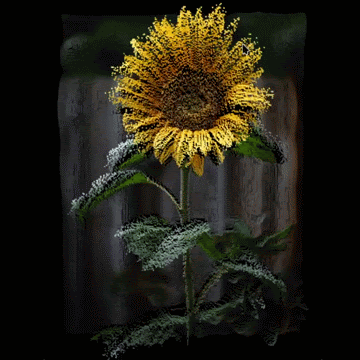

# Projet-NSI




## Présentation 

Ce projet a été réalisé par Sami El Maqrini et Adam Laroui.

Il reprend tous les exercices demandées en processing, et en python. 

## Note

Certains exercices, ont été réalisé par commentaires sur les fichiers sketches et/ou python. 

Par exemple, l'exercice "Une image 2D mappée en 3D" est répondu par un commentaire au début du fichier 14.py

## Structure

Notre projet est structuré en 3 dossiers principaux, tout d'abord 

le dossier "sketches" qui contient les différents projets processing
pour chaque exercice.

Ensuite le dossier "src" Qui contient les versions python de tout les sketches. 

Enfin le dossier "assets" Qui contient les images utilisées par les sketches et
scripts python. 

## Dépendences

Les scripts python utilisent la librairies py5, qui permet d'utiliser processing sur python3, 
et tkinter, afin de faire le launcher.

## Guide d'usage 

**Clonez le dêpot**

```bash
git clone https://github.com/samehhhhhhhh/Projet-NSI.git
cd Projet-NSI
```

**Pour processing :**
Il vous faudra les ouvrir sur l'IDE processing.

**Pour les scripts python :**

Il vous faut avoir python version 3 et pip d'installés sur votre machine. 
 
1. **créer un virtual environement pour le projet :**
```bash
# toujours dans le dossier
python -m venv .venv
```

2. **Activer le l'environement virtuel :**
   * **Sur Windows (Command Prompt) :**
     ```cmd
     .venv\Scripts\activate.bat
     ```
   * **Sur Windows (PowerShell) :**
     ```powershell
     .venv\Scripts\Activate.ps1
     ```
   * **Sur macOS et Linux :**
     ```bash
     source .venv/bin/activate
     ```

3. **Installez les dépendances :**
```bash
pip install --upgrade pip # Mettre à jour pip
pip install py5
pip install tk
```

4. **Lancer le launcher :**
```bash
python launcher.py
```
